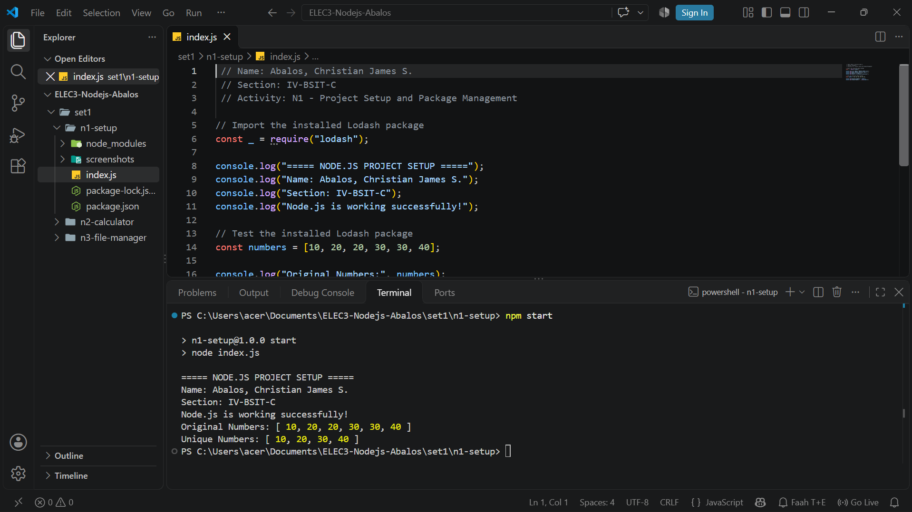
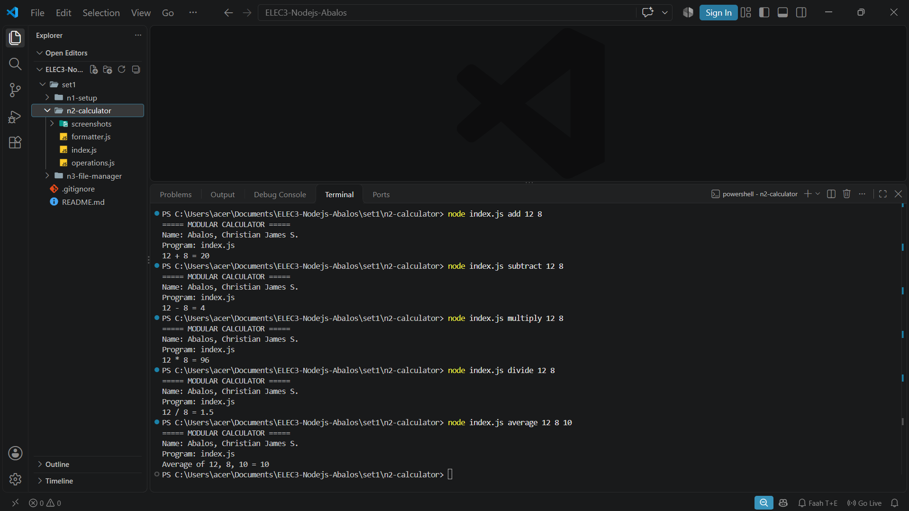
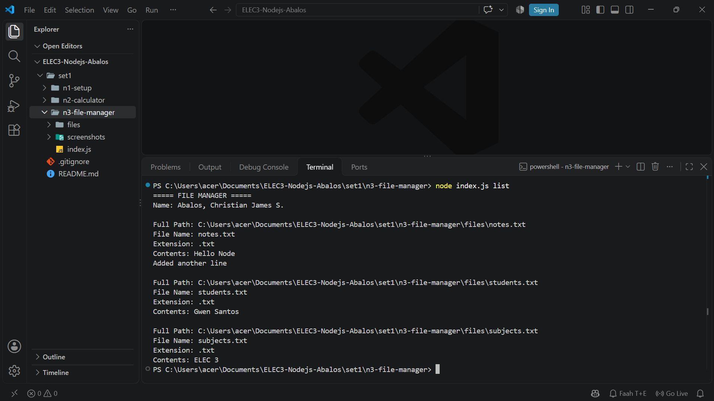

# ELEC 3 - Node.js Programming

**Name:** Abalos, Christian James S.  
**Section:** IV-BSIT-C  
**Course:** ELEC 3 - Node.js Programming

## Set 1 Activities

### N1 - Project Setup and Package Management
Node.js and npm setup, dependency installation, npm scripts, and Lodash example.

Run from `set1/n1-setup`:
```powershell
npm install
npm start
```

[View N1 folder](set1/n1-setup)



### N2 - Modular Calculator
Custom modules with CommonJS exports/imports, arithmetic operations, and validation.

Run from repository root:
```powershell
node set1/n2-calculator/index.js add 12 8
node set1/n2-calculator/index.js average 12 8 10
```

[View N2 folder](set1/n2-calculator)



### N3 - File Manager with fs and path
Command-line file operations with safe file names and an included `files` folder.

Run from repository root:
```powershell
node set1/n3-file-manager/index.js create notes.txt "Hello"
node set1/n3-file-manager/index.js list
```

[View N3 folder](set1/n3-file-manager)


